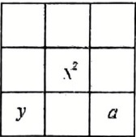
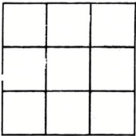

小明设计了一个问题，分三步完成:

(1) 已知关于 $x$ 的一元一次方程 $(a - 2)x^{|a|} - 1 + 8 = 0$，请完成数轴，并在数轴上标注 $a$ 与 $x^2$ 对应的点，分别记作 $A$、 $B$。

(2) 在（1）的条件下，在数轴上另有一点 C 对应的数为 y，C 与 A 的距离是 C 与 B 的距离的 5 倍，且 C 在表示 5 的点的左侧.

(3) 请结合（1）（2）提供的条件和图 $①$，在图 $②$ 中的9个方格内填上恰当的数，使每一行、每一列、每条斜对角线的数的和相等.

$①$

$②$

> [!question]- 点击查看答案与解析
> 【答案】(1) $a = -2$，$x = 2$，数轴上标注 A（$-2$）、B（$4$）；(2) $y = 3$；(3) 九宫格见解析
>
> 【考点】一元一次方程的定义、数轴、九宫格 → [[【初中数学知识点体系-人教版】#5-1 方程]]
>
> 【解析】
> (1) 方程 $(a - 2)x^{|a| - 1} + 8 = 0$ 是关于 $x$ 的一元一次方程，
> 则 $|a| - 1 = 1$ 且 $a - 2 \neq 0$。
> 由 $|a| = 2$，得 $a = \pm 2$，又 $a \neq 2$，所以 $a = -2$。
> 方程为 $(-2 - 2)x + 8 = 0$，即 $-4x + 8 = 0$，$x = 2$。
> $x^{2} = 4$。
> 在数轴上标注 A（$-2$）、B（$4$）。
> (2) C 表示 $y$，C 到 A 的距离 $|y - (-2)| = |y + 2|$，
> C 到 B 的距离 $|y - 4|$。
> $|y + 2| = 5|y - 4|$，且 $y < 5$。
> 分情况讨论：
> 当 $y \geq 4$ 时（结合 $y < 5$，即 $4 \leq y < 5$）：
> $y + 2 = 5(y - 4)$，$y + 2 = 5y - 20$，$4y = 22$，$y = \frac{11}{2} = 5.5$（不满足 $y < 5$，舍去）；
> 当 $-2 \leq y < 4$ 时：
> $y + 2 = 5(4 - y)$，$y + 2 = 20 - 5y$，$6y = 18$，$y = 3$（满足）；
> 当 $y < -2$ 时：
> $-(y + 2) = 5(4 - y)$，$-y - 2 = 20 - 5y$，$4y = 22$，$y = \frac{11}{2} = 5.5$（不满足 $y < -2$，舍去）。
> 所以 $y = 3$。
> (3) 九宫格（幻方）：
> 由(1)知 $a = -2$，$x^{2} = 4$。
> 幻方中心为 $1$（因为 A 到 B 的中点为 $\frac{-2+4}{2} = 1$）。
> 幻和（每行、每列、对角线之和）为 $3 \times 1 = 3$。
> 一个标准的以 1 为中心的 3 阶幻方（填入整数）：
> $$\begin{array}{|c|c|c|}
> \hline
> 0 & 5 & -2 \\
> \hline
> -1 & 1 & 3 \\
> \hline
> 4 & -3 & 2 \\
> \hline
> \end{array}$$
> 验证：每行和为 $3$，每列和为 $3$，对角线和为 $3$。
>
> 【易错点】(1) 一元一次方程中系数不为 0 的条件忽略；(2) 绝对值方程未正确分类讨论；(3) 九宫格构造方法不熟练
