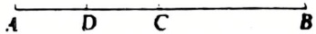

如图，点 C 是线段 AB 的中点，点 D 是线段 AC 的中点，若 AB=8，则 CD 的长为（）

A. 2

B. 4

C. 6

D. 8

> [!question]- 点击查看答案与解析
> 【答案】A
>
> 【考点】线段中点 → [[【初中数学知识点体系-人教版】#6-2 直线、射线、线段]]
>
> 【解析】因为点$C$是线段$AB$的中点，$AB = 8$，所以$AC = BC = \frac{1}{2}AB = 4$。因为点$D$是线段$AC$的中点，所以$CD = \frac{1}{2}AC = \frac{1}{2} \times 4 = 2$。
>
> 【易错点】混淆中点的定义，或在连续使用中点时计算错误。
