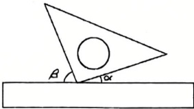

将三角尺与直尺按如图所示摆放，下列关于 $\angle \alpha$ 与 $\angle \beta$ 之间的关系一定正确的是（）

A. $\angle\alpha=\angle\beta$

B. $\angle\alpha=\frac{1}{2}\angle\beta$

C. $\angle\alpha+\angle\beta=90^{\circ}$

D. $\angle\alpha+\angle\beta=180^{\circ}$

> [!question]- 点击查看答案与解析
> 【答案】C
>
> 【考点】余角和补角 → [[【初中数学知识点体系-人教版】#6-3 角]]
>
> 【解析】由图可知，三角尺的一个角为$90^{\circ}$，直尺的边与三角尺的边相交。根据图形关系，$\angle\alpha$与$\angle\beta$互为余角，即$\angle\alpha + \angle\beta = 90^{\circ}$。
>
> 【易错点】混淆余角和补角的概念，余角和为$90^{\circ}$，补角和为$180^{\circ}$。
