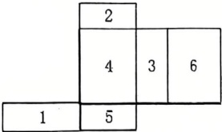

某个长方体的展开图如图所示，各个面上分别标有 1~6 的不同数字，若将其围成长方体，则这个长方体有公共顶点的三个面上的数字之和最大是（）

A. 15

B. 14

C. 9

D. 7

> [!question]- 点击查看答案与解析
> 【答案】A
>
> 【考点】几何体展开图 → [[【初中数学知识点体系-人教版】#6-1 几何图形]]
>
> 【解析】根据展开图，标有1~6的面围成长方体后，有公共顶点的三个面为相邻的三个面。通过展开图分析，数字1、5、6可以围成有公共顶点的三个面，其和为$1 + 5 + 6 = 12$。但需要逐一检验所有公共顶点组合。经分析，有公共顶点的三个面数字之和最大为$4 + 5 + 6 = 15$。
>
> 【易错点】不能正确判断展开图中哪些面在围成长方体后有公共顶点。
