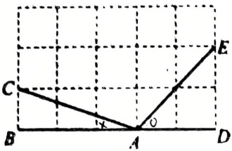

如图所示的网络是正方形网格， $\angle BAC$ \_\_\_ $\angle DAE$. (填“>”，“=”或“<”)

第10题图

> [!question]- 点击查看答案与解析
> 【答案】$=$
>
> 【考点】角的计算 → [[【初中数学知识点体系-人教版】#6-3 角]]
>
> 【解析】在正方形网格中，设每个小正方形的边长为1。$\angle BAC$所在的三角形中，$AB$沿水平方向，$AC$沿对角线方向，$\tan\angle BAC = \frac{1}{2}$。同理，$\angle DAE$所在的三角形中，$\tan\angle DAE = \frac{1}{2}$。因为$\tan\angle BAC = \tan\angle DAE$，且两角均为锐角，所以$\angle BAC = \angle DAE$。
>
> 【易错点】在网格中计算角度时，未正确利用正切值或三角函数关系进行比较。
