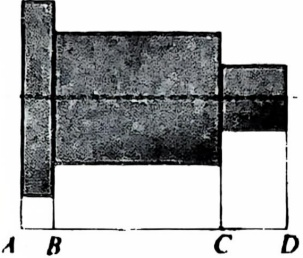

一种零件的图纸如图所示，若 AB=10mm，BC=50mm，CD=20mm，则 AD 的长为 \_\_\_ mm.

第11题图

> [!question]- 点击查看答案与解析
> 【答案】80
>
> 【考点】线段的和差计算 → [[【初中数学知识点体系-人教版】#6-2 直线、射线、线段]]
>
> 【解析】由图可知，$A$、$B$、$C$、$D$四点依次排列在一条直线上。$AD = AB + BC + CD = 10 + 50 + 20 = 80$（mm）。
>
> 【易错点】线段长度的计算中，忽略各段的顺序关系，导致加减错误。
