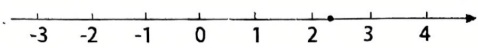

有理数 $a$ 在数轴上的对应点的位置如图所示，若有理数 $b$ 满足 $|b| < a$，则 $b$ 的值可以是\_\_\_，

(写出一个满足题意的具体数值)

第13题图

> [!question]- 点击查看答案与解析
> 【答案】0（答案不唯一，满足$-a < b < a$的任意有理数均可）
>
> 【考点】数轴、绝对值、有理数大小比较 → [[【初中数学知识点体系-人教版】#1-2 有理数及其大小比较]]
>
> 【解析】由数轴可知$a > 2$（例如$a \approx 2.5$）。由$|b| < a$，得$-a < b < a$。取$b = 0$即满足条件（答案不唯一，如$b = 1$、$b = -1$等均可）。
>
> 【易错点】忽略$|b| < a$表示的是一个范围$-a < b < a$，而非具体数值；忘记答案不唯一。
