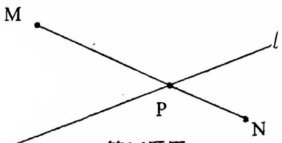

如图，在一条笔直的马路(直线 l)两侧各有一个居民区(点 M, N)，如果要在这条马路旁建一个购物中心，使购物中心到这两个小区的距离之和最小，那么购物中心应建在线段 MN 与直线 l 的交点 P 处，这样做的依据是 \_\_\_

第14题图

> [!question]- 点击查看答案与解析
> 【答案】两点之间，线段最短
>
> 【考点】线段的性质 → [[【初中数学知识点体系-人教版】#6-2 直线、射线、线段]]
>
> 【解析】要使购物中心到两个小区的距离之和最小，即$PM + PN$最小。因为$M$、$N$在直线$l$两侧，根据"两点之间，线段最短"，连接$MN$，与直线$l$的交点$P$即为所求，此时$PM + PN = MN$为最小值。
>
> 【易错点】不能将"两点之间，线段最短"与"点到直线的距离"混淆。
