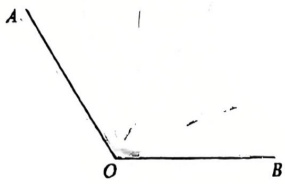
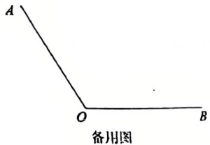

已知 $\angle AOB = 120^\circ$，射线 OC 在 $\angle AOB$ 的内部，射线 OM 是 $\angle AOC$ 靠近 OA 的三等分线，射线 ON 是 $\angle BOC$ 靠近 OB 的三等分线.

(1) 若 OC 平分 $\angle AOB$,

①依题意补全图1；

②∠MON 的度数为\_\_\_.

(2) 当射线 OC 绕点 O 在 ∠AOB 的内部旋转时，∠MON 的度数是否改变？若不变求 ∠MON 的度数；若改变，说明理由。

图 1

备用图

> [!question]- 点击查看答案与解析
> 【答案】$(1)$ ② $80^{\circ}$；$(2)$ 不变，$\angle MON = 80^{\circ}$
>
> 【考点】角的计算、角平分线、三等分线 → [[【初中数学知识点体系-人教版】#6-3 角]]
>
> 【解析】$(1)$ ① 补全图形：作$\angle AOB = 120^{\circ}$，OC平分$\angle AOB$，作OM为$\angle AOC$靠近OA的三等分线，作ON为$\angle BOC$靠近OB的三等分线。
> ② $\because OC$平分$\angle AOB$，$\therefore \angle AOC = \angle BOC = 60^{\circ}$。
> $\because OM$是$\angle AOC$靠近OA的三等分线，$\therefore \angle MOC = \frac{2}{3} \times 60^{\circ} = 40^{\circ}$。
> $\because ON$是$\angle BOC$靠近OB的三等分线，$\therefore \angle NOC = \frac{2}{3} \times 60^{\circ} = 40^{\circ}$。
> $\therefore \angle MON = \angle MOC + \angle NOC = 40^{\circ} + 40^{\circ} = 80^{\circ}$。
>
> $(2)$ 不变。设$\angle AOC = \theta$，则$\angle BOC = 120^{\circ} - \theta$。
> $\because OM$是$\angle AOC$靠近OA的三等分线，$\therefore \angle MOC = \frac{2}{3}\theta$。
> $\because ON$是$\angle BOC$靠近OB的三等分线，$\therefore \angle NOC = \frac{2}{3}(120^{\circ} - \theta)$。
> $\therefore \angle MON = \angle MOC + \angle NOC = \frac{2}{3}\theta + \frac{2}{3}(120^{\circ} - \theta) = \frac{2}{3} \times 120^{\circ} = 80^{\circ}$。
> $\therefore \angle MON$的度数不随OC的位置改变，始终为$80^{\circ}$。
>
> 【易错点】不理解"靠近OA的三等分线"的含义，靠近OA意味着$\angle AOM = \frac{1}{3}\angle AOC$。
