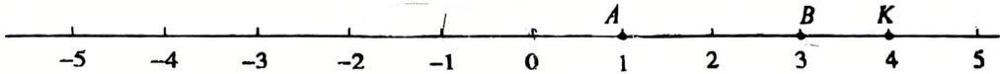

在数轴上，点 A 表示的数为 1，点 B 表示的数为 3. 对于数轴上的图形 M，给出如下定义；P 为图形 M 上任意一点，Q 为线段 AB 上任意一点，如果线段 PQ 的长度有最小值，那么称这个最小值为图形 M 关于线段 AB 的极小距离，记作 $d_{1}$ (M，线段 AB)；如果线段 PQ 的长度有最大值，那么称这个最大值为图形 M 关于线段 AB 的极大距离，记作 $d_{2}$ (M，线段 AB)，例如：点 K 表示的数为 4，则 $d_{1}$ (点 K，线段 AB)=1， $d_{2}$ (点 K，线段 AB)=3.

已知点 O 为数轴原点，点 C，D 为数轴上的动点.

(1) $d_{1}$ (点 O，线段 AB)=\_\_\_， $d_{2}$ (点 O，线段 AB)=\_\_\_；

(2) 若点 C, D 表示的数分别为 m, $m+2$, $d_{1}$ (线段 CD, 线段 AB)=2. 求 m 的值;

(3) 点 C 从原点出发，以每秒 2 个单位长度沿 x 轴正方向匀速运动；点 D 从表示数 -2 的点出发，第 1 秒以每秒 2 个单位长度沿 x 轴正方向匀速运动，第 2 秒以每秒 4 个单位长度沿 x 轴负方向匀速运动，第 3 秒以每秒 6 个单位长度沿 x 轴正方向匀速运动，第 4 秒以每秒 8 个单位长度沿 x 轴负方向匀速运动，……，按此规律运动，C，D 两点同时出发，设运动的时间为 t 秒，若 $d_{2}$（线段 CD，线段 AB）小于或等于 6，直接写出 t 的取值范围。（t 可以等于 0）

> [!question]- 点击查看答案与解析
> 【答案】$(1)$ 1，3；$(2)$ $m = -3$或$m = 5$；$(3)$ $0 \leq t \leq \frac{7}{4}$或$\frac{13}{6} \leq t \leq \frac{7}{2}$
>
> 【考点】数轴上的动点问题、新定义理解 → [[【初中数学知识点体系-人教版】#1-2 有理数及其大小比较]]
>
> 【解析】$(1)$ 点O表示的数为0，线段AB表示的数为$[1, 3]$。
> $d_{1}$(点O，线段AB)为点O到AB的最小距离$= 1 - 0 = 1$。
> $d_{2}$(点O，线段AB)为点O到AB的最大距离$= 3 - 0 = 3$。
>
> $(2)$ 线段CD表示$[m, m + 2]$，线段AB表示$[1, 3]$。
> $d_{1}$(线段CD，线段AB) $= 2$分两种情况：
> ① CD在AB左侧：$m + 2 < 1$，最小距离$= 1 - (m + 2) = -m - 1 = 2$，解得$m = -3$。
> ② CD在AB右侧：$m > 3$，最小距离$= m - 3 = 2$，解得$m = 5$。
> 综上，$m = -3$或$m = 5$。
>
> $(3)$ 点C表示的数为$2t$。
> 点D的运动规律：第$k$秒速度为$2k$，奇数秒正向、偶数秒负向。
> D在各整数时刻的位置：$D(0) = -2$，$D(1) = 0$，$D(2) = -4$，$D(3) = 2$，$D(4) = -6$，$D(5) = 4$，……
> 归纳得：$n$为偶数时$D(n) = -2 - n$，$n$为奇数时$D(n) = n - 1$。
> 经分析，$C \geq D$恒成立，线段CD为$[D, C]$。
>
> $d_{2}$(线段CD，线段AB) $= \max(|D - 1|, |D - 3|, |C - 1|, |C - 3|) \leq 6$，
> 即$D \geq -3$且$C \leq 7$。
>
> 由$C = 2t \leq 7$得$t \leq \frac{7}{2}$。
> 由$D \geq -3$分段求解：
> $0 \leq t \leq 1$：$D = -2 + 2t \geq -3$恒成立。
> $1 < t \leq 2$：$D = 4 - 4t \geq -3$，得$t \leq \frac{7}{4}$。
> $2 < t \leq 3$：$D = 6t - 16 \geq -3$，得$t \geq \frac{13}{6}$。
> $3 < t \leq \frac{7}{2}$：$D = 26 - 8t \geq -3$，$D(\frac{7}{2}) = -2 > -3$恒成立。
>
> 综上，$t$的取值范围为$0 \leq t \leq \frac{7}{4}$或$\frac{13}{6} \leq t \leq \frac{7}{2}$。
>
> 【易错点】$(3)$中D的运动规律复杂，需逐段分析其位置表达式；极大距离的理解需取线段端点到目标线段端点的最大距离。
