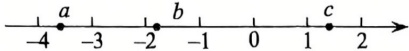

有理数 a，b，c 在数轴上的对应点的位置如图所示，则正确的结论是（）

A. $b-c<0$

B. $c>-a$

C. $ac>0$

D. $\left|c\right|>\left|a\right|$

> [!question]- 点击查看答案与解析
> 【答案】A
> 
> 【考点】数轴上点的位置判断符号与绝对值大小 → [[【初中数学知识点体系-人教版】#1-2 有理数及其大小比较]]
> 
> 【解析】
> 由数轴可知：$-4<a<-3$，$-2<b<-1$，$1<c<2$。逐项分析：
> A. 由 $b<0<c$ 得 $b-c<0$，正确；
> B. $-a$ 满足 $3<-a<4$，而 $1<c<2$，故 $c<-a$，$c>-a$ 错误；
> C. $a<0$，$c>0$，异号得负，$ac<0$，错误；
> D. $\left|a\right|>3$，$\left|c\right|<2$，故 $\left|c\right|<\left|a\right|$，错误。
> 
> 【易错点】比较 $c$ 与 $-a$ 时把 $-a$ 误当作负数，或忽略到原点的距离直接比大小。
