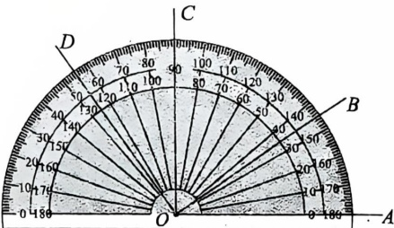

如图所示，用量角器度量一些角的度数，下列结论中 $\underset{\cdot}{错}\underset{\cdot}{误}$ 的是（ ）

A. $OA \perp OC$

B. $\angle AOD = 135^\circ$

C. $\angle AOB = \angle COD$

D. $\angle BOC$ 与 $\angle AOD$ 互补

> [!question]- 点击查看答案与解析
> 【答案】B
> 
> 【考点】用量角器度量角、垂线与补角 → [[【初中数学知识点体系-人教版】#6-3 角]]
> 
> 【解析】
> 以 $OA$ 为 $0^\circ$ 起始边，由量角器读数得 $\angle AOB=40^\circ$，$\angle AOC=90^\circ$，$\angle AOD=130^\circ$。逐项分析：
> A. $\angle AOC=90^\circ$，所以 $OA \perp OC$，正确；
> B. $\angle AOD=130^\circ \ne 135^\circ$，错误；
> C. $\angle COD=130^\circ-90^\circ=40^\circ=\angle AOB$，正确；
> D. $\angle BOC=90^\circ-40^\circ=50^\circ$，$\angle BOC+\angle AOD=50^\circ+130^\circ=180^\circ$，两角互补，正确。
> 
> 【易错点】误读量角器内、外圈刻度，把 $\angle AOD$ 当成 $135^\circ$ 而漏选 B。
