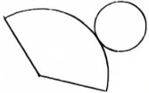
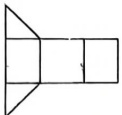
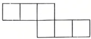
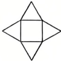

如图，$①～④$ 展开图中，能围成三棱柱的是 ___ .

$①$

$②$

$③$

$④$

> [!question]- 点击查看答案与解析
> 【答案】$②$
>
> 【考点】立体图形的展开与折叠 → [[【初中数学知识点体系-人教版】#6-1 几何图形]]
>
> 【解析】
> 三棱柱由 3 个长方形侧面和 2 个三角形底面组成，其展开图应由 3 个矩形和 2 个三角形构成，且位置能够围合。
> $①$：由一个扇形和一个圆组成，是圆锥的展开图，不能围成三棱柱；
> $②$：由 3 个矩形和 2 个三角形组成，两个三角形分别位于矩形排的两侧，折叠后恰好围成三棱柱，能围成；
> $③$：由 6 个正方形组成，是正方体的展开图，不能围成三棱柱；
> $④$：由 1 个正方形和 4 个三角形组成，是四棱锥的展开图，不能围成三棱柱。
> 所以能围成三棱柱的是 $②$。
>
> 【易错点】只关注图形的种类而忽略排列位置，误认为只要有 2 个三角形和 3 个矩形就一定能围成三棱柱；混淆棱柱与棱锥、圆锥的展开图特征。
