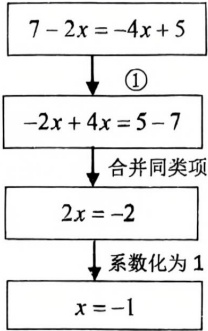

右面是小宁解方程 $7-2x=4x-5$ 的过程．$①$ 代表的运算步骤为：___ ，该步骤对方程进行变形的依据是 ___ .

> [!question]- 点击查看答案与解析
> 【答案】移项；等式性质 1（等式两边同时加（或减）同一个数或式，结果仍相等）
>
> 【考点】解一元一次方程的步骤、移项的依据 → [[【初中数学知识点体系-人教版】#5-2 解一元一次方程]]
>
> 【解析】
> 由图中流程图，步骤 $①$ 把方程 $7-2x=-4x+5$ 变形为 $-2x+4x=5-7$：把右边的项 $-4x$ 移到左边变为 $+4x$，把左边的项 7 移到右边变为 $-7$，这一运算步骤是移项。
> 移项的本质是等式两边同时加（或减）同一个数或式，结果仍相等，所以该步骤变形的依据是等式性质 1。
>
> 【易错点】移项时忘记变号；把移项的依据误写成等式性质 2（两边同乘或同除一个不为 0 的数）或乘法分配律。
