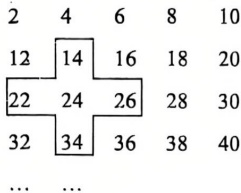

对连续的偶数 2，4，6，8，… 排成如右图的形式. 若将图中的十字框上下左右移动，框住的五个数之和能等于 2020 吗？若能，请写出这五个数中位置在最中间的数；若不能，请说明理由. 你的答案是： ___ .

> [!question]- 点击查看答案与解析
> 【答案】能，最中间的数为 404
>
> 【考点】数阵规律探索与列一元一次方程 → [[【初中数学知识点体系-人教版】#5-3 实际问题与一元一次方程]]
>
> 【解析】
> 由数阵图可知每行排 5 个连续偶数，左右相邻两数相差 2，上下相邻两数相差 10。十字框中心为数 $x$ 时，上、下、左、右四数依次为 $x-10$、$x+10$、$x-2$、$x+2$，五个数之和 $=(x-10)+(x-2)+x+(x+2)+(x+10)=5x$，即五数之和恒为中间数的 5 倍。令 $5x=2020$，解得 $x=404$。检验位置：$404=2\times202$ 是第 202 个偶数，$202=40\times5+2$，故 404 位于第 41 行第 2 列，不在第 1 列或第 5 列的边缘位置，十字框可以完整框住它，此时五个数为 394、402、404、406、414，其和恰为 2020。所以能，最中间的数是 404。
>
> 【易错点】只解出 $x=404$ 而不检验它在数阵中的位置：若中间数落在第 1 列或第 5 列，左右两数不存在，十字框框不全五个数；另外上下相邻两数相差 10 而非 2，看错排列规律会导致列式错误。
