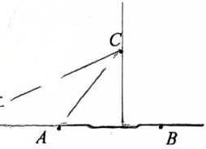
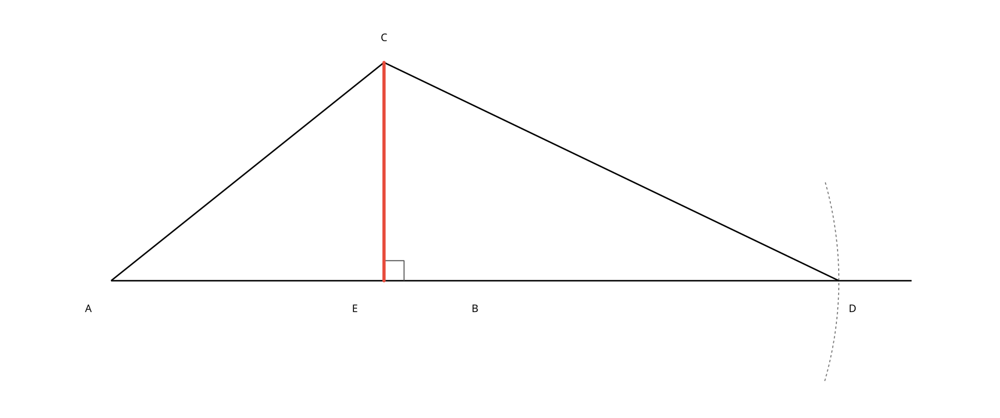

如图，平面上有三个点 A, B, C.

（1）根据下列语句按要求画图.

$①$ 画射线 $AB$，用圆规在线段 $AB$ 的延长线上截取 $BD=AB$（保留作图痕迹）；

$②$ 连接 $CA$，$CD$；

$③$ 过点 $C$ 画 $CE\perp AD$，垂足为 $E$.

（2）在线段 $CA$，$CE$，$CD$ 中，线段最短，依据是 ___

> [!question]- 点击查看答案与解析
> 【答案】（1）画图步骤见【解析】；（2）线段 $CE$ 最短，依据是垂线段最短
> 
> 【考点】根据语句画图（射线、线段的延长线、垂线）、垂线段最短 → [[【初中数学知识点体系-人教版】#6-2 直线、射线、线段]]
> 
> 【解析】
> （1）画图步骤：
> $①$ 过点 $A$、$B$ 画直线，以 $A$ 为端点、经过 $B$ 并向 $B$ 方向延伸的部分即为射线 $AB$；把圆规两脚张开到 $AB$ 的长度，以点 $B$ 为圆心画弧，交线段 $AB$ 的延长线（即越过 $B$、远离 $A$ 的一侧）于点 $D$，则 $BD=AB$，保留弧痕；
> $②$ 用直尺连接线段 $CA$ 和线段 $CD$；
> $③$ 将三角尺的一条直角边与直线 $AD$ 重合，沿 $AD$ 平移三角尺，使另一条直角边经过点 $C$，沿该直角边过 $C$ 画直线交 $AD$ 于点 $E$，则 $CE\perp AD$，垂足为 $E$。
> （2）因为 $CE\perp AD$ 于 $E$，而点 $A$、$D$ 都在直线 $AD$ 上，$CA$、$CD$ 是点 $C$ 与直线 $AD$ 上点的连线中的斜线段。由"连接直线外一点与直线上各点的所有线段中，垂线段最短"，得 $CE<CA$ 且 $CE<CD$，所以线段 $CA$、$CE$、$CD$ 中线段 $CE$ 最短，依据是垂线段最短。
> 
> 
> 
> 【易错点】截取 $BD=AB$ 必须画在线段 $AB$ 的延长线上（越过 $B$ 的一侧），不能画到 $BA$ 的延长线上；作图要保留圆规弧痕并标明字母；（2）的依据是"垂线段最短"，不要误写成"两点之间线段最短"。
