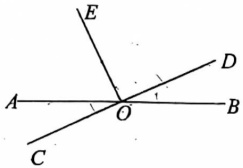

如图，直线 $AB$，$CD$ 相交于点 $O$，$OE \perp CD$ 于点 $O$，$\angle EOB = 115^\circ$，求 $\angle AOC$ 的度数。请补全下面的解题过程（括号中填写推理的依据）。

∵ $OE \perp CD$ 于点 $O$ (已知),

∴ ___ ( ___ ).

∵ ∠EOB = 115° (已知),

∴ ∠DOB = ___ = 115° - 90° = 25°.

∵ 直线 $AB$, $CD$ 相交于点 $O$ (已知),

∴ ∠AOC = ___ = 25° ( ___ ).

> [!question]- 点击查看答案与解析
> 【答案】$\angle AOC=25^\circ$
> 
> 【考点】垂直的定义、角的和差计算、对顶角 → [[【初中数学知识点体系-人教版】#6-2 直线、射线、线段]], [[【初中数学知识点体系-人教版】#6-3 角]]
> 
> 【解析】
> 补全解题过程如下：
> ∵ $OE\perp CD$ 于点 $O$（已知），
> ∴ $\angle EOD=90^\circ$（垂直的定义）。
> ∵ $\angle EOB=115^\circ$（已知），由图可知射线 $OD$ 在 $\angle EOB$ 的内部，
> ∴ $\angle DOB=\angle EOB-\angle EOD=115^\circ-90^\circ=25^\circ$。
> ∵ 直线 $AB$、$CD$ 相交于点 $O$（已知），$\angle AOC$ 与 $\angle DOB$ 的两边互为反向延长线，是一对对顶角，
> ∴ $\angle AOC=\angle DOB=25^\circ$（对顶角相等）。
> 即三个空依次填：$\angle EOD=90^\circ$（垂直的定义）；$\angle EOB-\angle EOD$；$\angle DOB$（对顶角相等）。
> 
> 【易错点】要结合图形识别射线 $OD$ 在 $\angle EOB$ 内部，用角的差求 $\angle DOB$；$\angle AOC$ 的对顶角是 $\angle BOD$，不要与邻补角 $\angle AOD$ 混淆；最后一步的依据写"对顶角相等"。
