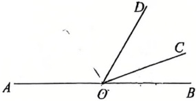
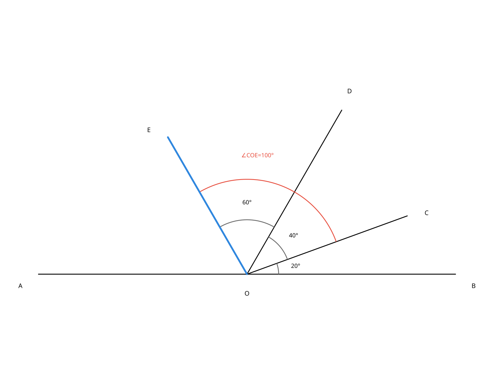
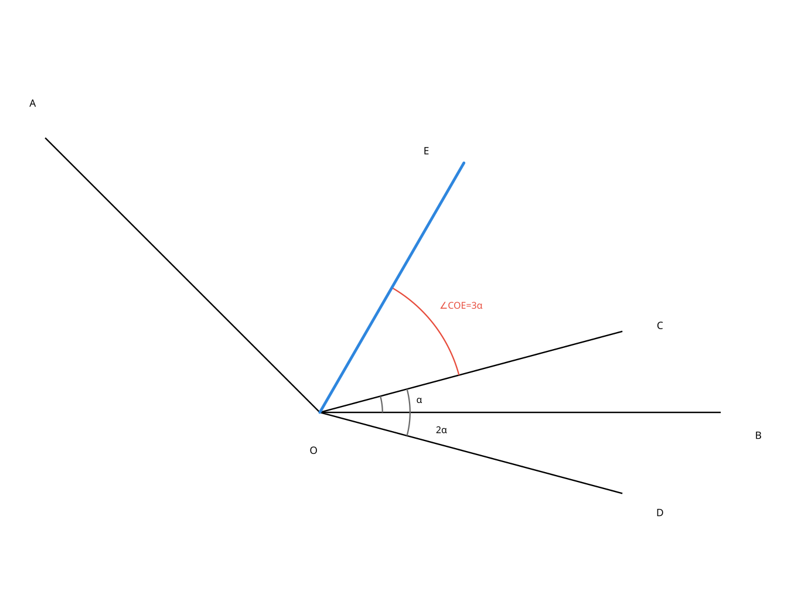

已知：射线 $OC$ 在 $\angle AOB$ 的内部，$\angle AOC: \angle BOC = 8:1$，$\angle COD = 2\angle COB$，$OE$ 平分 $\angle AOD$。

（1）如图，若点 $A$，$O$，$B$ 在同一条直线上，$OD$ 是 $\angle AOC$ 内部的一条射线，请根据题意补全图形，并求 $\angle COE$ 的度数；

（2）若 $\angle BOC = \alpha (0^\circ < \alpha < 18^\circ)$，直接写出 $\angle COE$ 的度数（用含 $\alpha$ 的代数式表示）.

> [!question]- 点击查看答案与解析
> 【答案】（1）$\angle COE=100^\circ$；（2）$\angle COE=5\alpha$ 或 $3\alpha$
> 
> 【考点】角的和差计算、角平分线的定义、分类讨论 → [[【初中数学知识点体系-人教版】#6-3 角]]
> 
> 【解析】
> （1）补全图形：在 $\angle AOC$ 内部画射线 $OD$（靠近 $OC$），再在 $\angle AOD$ 内部画射线 $OE$。
> 因为点 $A$、$O$、$B$ 在同一条直线上，所以 $\angle AOB=180^\circ$。由 $\angle AOC:\angle BOC=8:1$，得 $\angle BOC=180^\circ\times\frac{1}{8+1}=20^\circ$，$\angle AOC=180^\circ-20^\circ=160^\circ$。
> 因为 $\angle COD=2\angle COB$，所以 $\angle COD=2\times20^\circ=40^\circ$；又 $OD$ 在 $\angle AOC$ 内部，所以 $\angle AOD=\angle AOC-\angle COD=160^\circ-40^\circ=120^\circ$。
> 因为 $OE$ 平分 $\angle AOD$，所以 $\angle DOE=\frac{1}{2}\angle AOD=60^\circ$（角平分线的定义）。
> 所以 $\angle COE=\angle COD+\angle DOE=40^\circ+60^\circ=100^\circ$。
> （2）由 $\angle BOC=\alpha$ 且 $\angle AOC:\angle BOC=8:1$，得 $\angle AOC=8\alpha$；$\angle COD=2\angle COB=2\alpha$。射线 $OD$ 相对 $OC$ 的位置不确定，需分类讨论：
> 情形 $①$：$OD$ 在 $\angle AOC$ 内部（$OC$ 靠 $OA$ 一侧），则 $\angle AOD=\angle AOC-\angle COD=8\alpha-2\alpha=6\alpha$；$OE$ 平分 $\angle AOD$，得 $\angle DOE=3\alpha$，所以 $\angle COE=\angle COD+\angle DOE=2\alpha+3\alpha=5\alpha$；
> 情形 $②$：$OD$ 在 $\angle AOC$ 外部（$OC$ 靠 $OB$ 一侧），则 $\angle AOD=\angle AOC+\angle COD=8\alpha+2\alpha=10\alpha$；$OE$ 平分 $\angle AOD$，得 $\angle DOE=5\alpha$，所以 $\angle COE=\angle DOE-\angle COD=5\alpha-2\alpha=3\alpha$。
> 综上，$\angle COE=5\alpha$ 或 $\angle COE=3\alpha$（在 $0^\circ<\alpha<18^\circ$ 时两种情形均成立）。
> 
> 
> 
> 
> 
> 【易错点】（1）补全图形时 $OD$ 必须画在 $\angle AOC$ 内部、$OE$ 画在 $\angle AOD$ 内部；（2）不能漏掉 $OD$ 在 $OC$ 两侧的分类，两个答案 $5\alpha$ 与 $3\alpha$ 都要写；做角的和差时先看清射线的相对位置再列式。
