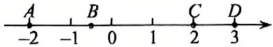

如图，数轴上有A，B，C，D四个点，所对应的数分别是a，b，c，d，下列各式的值最小的为( )

A. -a

B. d - a

C. $|b + c|$

D. $|a| + |b|$

> [!question]- 点击查看答案与解析
> 【答案】C
> 
> 【考点】数轴、绝对值、有理数大小比较 → [[【初中数学知识点体系-人教版】#1-2 有理数及其大小比较]]
> 
> 【解析】
> 由数轴可知：$a < b < 0 < c < d$。
> 选项A：$a < 0$，所以 $-a > 0$。
> 选项B：$d > 0$，$a < 0$，所以 $d - a = d + |a| > 0$，且数值较大。
> 选项C：$b < 0$，$c > 0$，且 $b$，$c$ 都接近原点，所以 $|b + c|$ 的值较小（$b$ 与 $c$ 异号相加，绝对值减小）。
> 选项D：$|a| + |b| > 0$，且 $|a|$ 较大（$a$ 离原点最远）。
> 比较可知 $|b + c|$ 最小。
> 
> 【易错点】数轴上越靠近原点的数，其绝对值越小；异号两数相加，绝对值互相抵消。
