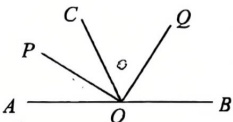

如图，O是直线AB上一点，OP平分 $\angle AOC$，OQ平分 $\angle BOC$，则图中互余的角共有( )

A. 1对

B. 2对

C. 3对

D. 4对

> [!question]- 点击查看答案与解析
> 【答案】D
> 
> 【考点】角平分线、互余的角 → [[【初中数学知识点体系-人教版】#6-3 角]]
> 
> 【解析】
> $O$ 在直线 $AB$ 上，所以 $\angle AOC + \angle BOC = 180^{\circ}$。
> $OP$ 平分 $\angle AOC$，所以 $\angle AOP = \angle POC = \frac{1}{2}\angle AOC$。
> $OQ$ 平分 $\angle BOC$，所以 $\angle COQ = \angle BOQ = \frac{1}{2}\angle BOC$。
> $\angle POC + \angle COQ = \frac{1}{2}(\angle AOC + \angle BOC) = \frac{1}{2} \times 180^{\circ} = 90^{\circ}$。
> 互余的角对有：$\angle AOP$ 与 $\angle COQ$、$\angle AOP$ 与 $\angle BOQ$、$\angle POC$ 与 $\angle COQ$、$\angle POC$ 与 $\angle BOQ$，共4对。
> 
> 【易错点】$\angle AOP = \angle POC$，$\angle COQ = \angle BOQ$，利用等量代换找齐所有互余的角对。
