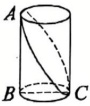
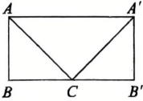
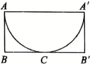
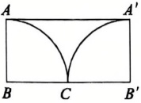
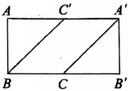

如图，已知 BC 是圆柱底面的直径，AB 是圆柱的高，在圆柱的侧面上，过点 A，C 嵌有一圈路径最短的金属丝，现将圆柱侧面沿 AB 剪开，所得的圆柱侧面展开图是（）

A

B

C

D

> [!question]- 点击查看答案与解析
> 【答案】B
> 
> 【考点】圆柱侧面展开图、最短路径 → [[【初中数学知识点体系-人教版】#6-1 几何图形]]
> 
> 【解析】
> 圆柱侧面沿 $AB$ 剪开后展开为矩形。
> 底面圆周展开为矩形的底边，$BC$ 是底面直径，展开后点 $C$ 位于底边的中点。
> 点 $A$ 在顶边上，点 $C$ 在底边中点。
> 圆柱侧面上 $A$ 到 $C$ 的最短路径，在展开图上为连接 $A$ 与 $C$ 的线段。
> 金属丝绕一圈回到 $A$，在展开图上是从 $A$ 到 $C$ 再到 $A'$（顶边另一端）的折线。
> 选项B的图形符合这一特征。
> 
> 【易错点】圆柱侧面展开是矩形，最短路径在展开图上是直线段；注意金属丝是"一圈"经过 $A$，$C$。
