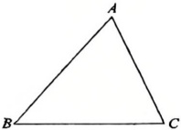

如图，在 $\triangle ABC$ 中，最长的边是\_\_\_.

第 12 题图

> [!question]- 点击查看答案与解析
> 【答案】$AB$
> 
> 【考点】三角形的边角关系 → [[【初中数学知识点体系-人教版】#13-2 与三角形有关的线段]]
> 
> 【解析】
> 在三角形中，大角对大边。
> 由图可知 $\angle C$ 是钝角（或最大角），所以 $\angle C$ 对的边 $AB$ 是最长边。
> 
> 【易错点】三角形中最长的边对应最大的角。
