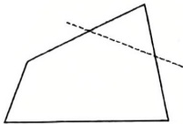

如图，剪去四边形的"一角"，得到一个五边形，这个五边形的周长一定***这个四边形的周长（填"大于"，"小于"或"等于"），依据是***.

第 13 题图

> [!question]- 点击查看答案与解析
> 【答案】小于；两点之间线段最短
> 
> 【考点】线段性质、周长的计算 → [[【初中数学知识点体系-人教版】#6-2 直线、射线、线段]]
> 
> 【解析】
> 剪去四边形的"一角"，原来的两条边的一部分被一条新的线段（剪切线）替代。
> 根据"两点之间线段最短"，新线段的长度小于原来两条边被替换部分的长度之和。
> 所以五边形的周长小于原四边形的周长。
> 
> 【易错点】理解"两点之间线段最短"的含义，剪切线替代了原来两条边的部分。
