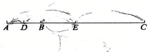

如图，B 是线段 AC 上一点，D，E 分别是线段 AB，AC 的中点，若 AB=1，BC=3，则 DE=\_\_\_。

第 14 题图

> [!question]- 点击查看答案与解析
> 【答案】$\frac{3}{2}$（或 $1.5$）
> 
> 【考点】线段中点、线段长度的计算 → [[【初中数学知识点体系-人教版】#6-2 直线、射线、线段]]
> 
> 【解析】
> $AB = 1$，$BC = 3$，所以 $AC = AB + BC = 1 + 3 = 4$。
> $D$ 是 $AB$ 中点，$AD = \frac{1}{2}AB = \frac{1}{2}$。
> $E$ 是 $AC$ 中点，$AE = \frac{1}{2}AC = \frac{1}{2} \times 4 = 2$。
> $DE = AE - AD = 2 - \frac{1}{2} = \frac{3}{2}$。
> 
> 【易错点】线段中点的定义是到两端点距离相等；计算 $DE$ 时注意 $DE = AE - AD$。
