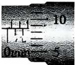
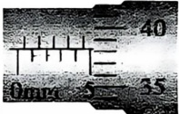

螺旋测微器又称千分尺，用它测长度可以准确到 0.01 mm. 它的读数方法是先读固定刻度，再读半刻度，若半刻度线已露出，记作 0.5 mm，若半刻度线未露出，记作 0.0 mm，再读可动刻度 n，记作 $n \times 0.01$ mm，最终读数结果为固定刻度+半刻度+可动刻度+估读. 例如图 1 的读数为 $2.586 \text{ mm}$，其中最后一位 "6" 为估读. 则图 2 的读数为 \_\_\_ mm.

图 1

图 2

> [!question]- 点击查看答案与解析
> 【答案】$3.681$
> 
> 【考点】螺旋测微器的读数方法 → [[【初中数学知识点体系-人教版】#3-2 代数式的值]]
> 
> 【解析】
> 图2中固定刻度露出 $3\text{ mm}$。
> 半刻度线已露出，加 $0.5\text{ mm}$。
> 可动刻度：第 $18$ 格附近对齐，读数为 $18.1 \times 0.01\text{ mm} = 0.181\text{ mm}$（含估读）。
> 最终读数 $= 3 + 0.5 + 0.181 = 3.681\text{ mm}$。
> 
> 【易错点】螺旋测微器读数需包含估读位；半刻度线是否露出要仔细辨认。
