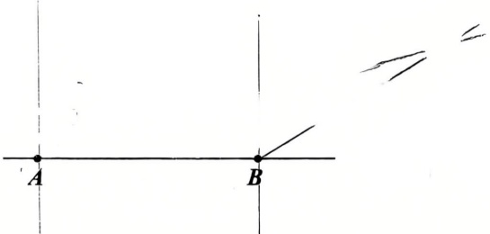

如图，A，B表示笔直的海岸边的两个观测点，从A地发现它的北偏东75°方向有一艘船，同时，从B地发现这艘船在它的北偏东60°方向.

(1) 在图中画出这艘船的位置，并用点 C 表示；

(2) 若此图的比例尺为 1:100000，请你通过画图、测量，计算出这艘船到海岸线 AB 的实际距离（精确到 1 千米）.

> [!question]- 点击查看答案与解析
> 【答案】（1）略（见图）；（2）约2千米
> 
> 【考点】方位角、比例尺、作图与测量 → [[【初中数学知识点体系-人教版】#6-3 角]]
> 
> 【解析】
> - （1）从 $A$ 点向北偏东 $75^{\circ}$ 方向画射线，从 $B$ 点向北偏东 $60^{\circ}$ 方向画射线，两条射线的交点即为船的位置 $C$。
> - （2）过 $C$ 作 $AB$ 的垂线段 $CD$，测量图上距离 $CD$ 的长度（约为 $2\text{ cm}$）。
> - 比例尺为 $1:100\,000$，即图上 $1\text{ cm}$ 代表实际 $100\,000\text{ cm} = 1\text{ km}$。
> - 所以实际距离约为 $2\text{ km}$。
> 
> 【易错点】方位角是从正北方向开始顺时针旋转的角度；比例尺换算时注意单位统一。
