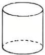
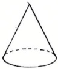
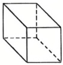
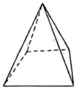

下列几何体中，是圆锥的为（）

A

B

C

D

> [!question]- 点击查看答案与解析
> 【答案】A
> 
> 【考点】常见几何体的识别 → [[【初中数学知识点体系-人教版】#6-1 几何图形]]
> 
> 【解析】
> - 圆锥的特征：底面是圆，侧面是曲面，有一个顶点。
> - 选项A是圆锥；选项B是圆柱；选项C是正方体；选项D是三棱柱。
> - 选项A正确。
> 
> 【易错点】区分圆锥、圆柱、棱柱等常见几何体的特征。
