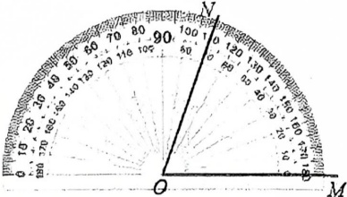

如图所示，用量角器度量 ∠MON，可以读出 ∠MON 的度数为（）

A. $60^{\circ}$

B. $70^{\circ}$

C. $110^{\circ}$

D. $115^{\circ}$

> [!question]- 点击查看答案与解析
> 【答案】B
> 
> 【考点】用量角器度量角的度数 → [[【初中数学知识点体系-人教版】#6-3 角]]
> 
> 【解析】
> - 用量角器量角时，量角器的中心与角的顶点重合，零刻度线与角的一边重合。
> - 读取另一边所对应的刻度。
> - 由图可知 $\angle MON$ 的度数为 $70^{\circ}$。
> 
> 【易错点】量角器有内外两圈刻度，注意读取正确的刻度圈。
