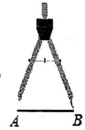
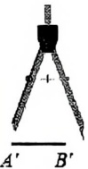

如图，用圆规比较两条线段 AB 和 $A'B'$ 的长短，其中正确的是（）

A. $A^{\prime}B^{\prime}>AB$

B. $A^{\prime}B^{\prime}=AB$

C. $A^{\prime}B^{\prime}<AB$

D. 没有刻度尺，无法确定

> [!question]- 点击查看答案与解析
> 【答案】A
> 
> 【考点】用圆规比较线段长短 → [[【初中数学知识点体系-人教版】#6-2 直线、射线、线段]]
> 
> 【解析】
> - 用圆规量取线段 $AB$ 的长度后，将其与线段 $A'B'$ 比较。
> - 由图可知圆规的开口（等于 $AB$ 的长度）小于 $A'B'$ 的长度。
> - 所以 $A'B' > AB$。
> - 选项A正确。
> 
> 【易错点】圆规量取的长度与目标线段端点位置的关系要准确判断。
