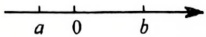

有理数 a，b 在数轴上的对应点的位置如图所示．把 -a, b, 0 按照从小到大的顺序排列，正确的是（）

A. 0 < -a < b

B. -a < 0 < b

C. b < 0 < -a

D. b < -a < 0

> [!question]- 点击查看答案与解析
> 【答案】C
> 
> 【考点】数轴、相反数、有理数大小比较 → [[【初中数学知识点体系-人教版】#1-2 有理数及其大小比较]]
> 
> 【解析】
> - 由数轴可知：$a < 0 < b$。
> - 因为 $a < 0$，所以 $-a > 0$。
> - 又因为 $a$ 到原点的距离大于 $b$ 到原点的距离（$a$ 更靠左），所以 $-a > b$。
> - 排序：$b < 0 < -a$。
> - 选项C正确。
> 
> 【易错点】$a < 0$ 时，$-a$ 是正数；比较大小要借助数轴，右边的数总比左边的数大。
