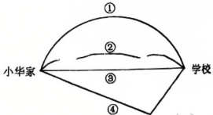

如图，从小华家去学校共有 4 条路，第\_\_\_条路最近．理由是：\_\_\_.

> [!question]- 点击查看答案与解析
> 【答案】③；两点之间线段最短
> 
> 【考点】线段性质 → [[【初中数学知识点体系-人教版】#6-2 直线、射线、线段]]
> 
> 【解析】
> - 由图可知，第③条路是连接小华家和学校的直线段。
> - 根据"两点之间线段最短"，第③条路最近。
> 
> 【易错点】在多条路径中，直线段是最短的。
