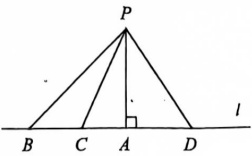

如图，P 是直线 l 外一点，从点 P 向直线 l 引 PA，PB，PC，PD 几条线段，其中只有 PA 与 l 垂直. 这几条线段中，最短的是 \_\_\_，依据是 \_\_\_.

> [!question]- 点击查看答案与解析
> 【答案】$PA$；垂线段最短
> 
> 【考点】垂线段的性质 → [[【初中数学知识点体系-人教版】#6-2 直线、射线、线段]]
> 
> 【解析】
> - 从直线外一点到直线上各点的所有连线中，垂线段最短。
> - $PA$ 与直线 $l$ 垂直，所以 $PA$ 最短。
> 
> 【易错点】"垂线段最短"是点到直线距离的定义基础，区别于"两点之间线段最短"。
