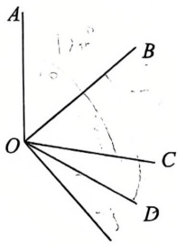

如图，OB 平分 ∠AOC，OD 平分 ∠COE，∠AOD = 120°，∠BOD = 70°，则 ∠COE 的度数为\_\_\_。

E

> [!question]- 点击查看答案与解析
> 【答案】$40^{\circ}$
> 
> 【考点】角平分线的定义、角的计算 → [[【初中数学知识点体系-人教版】#6-3 角]]
> 
> 【解析】
> - 设 $\angle AOB = \angle BOC = x$（$OB$ 平分 $\angle AOC$）。
> - 设 $\angle COD = \angle DOE = y$（$OD$ 平分 $\angle COE$）。
> - $\angle AOD = \angle AOB + \angle BOC + \angle COD = x + x + y = 2x + y = 120^{\circ}$。
> - $\angle BOD = \angle BOC + \angle COD = x + y = 70^{\circ}$。
> - 联立：$2x + y = 120^{\circ}$ 和 $x + y = 70^{\circ}$。
> - 两式相减：$x = 50^{\circ}$。
> - 代入 $x + y = 70^{\circ}$：$50^{\circ} + y = 70^{\circ}$，$y = 20^{\circ}$。
> - $\angle COE = 2y = 2 \times 20^{\circ} = 40^{\circ}$。
> 
> 【易错点】利用角平分线定义设未知数，列出方程组求解；注意 $\angle COE = 2\angle COD$。
