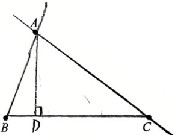

已知 A, B, C 三点的位置如图所示，用三角尺或直尺等按要求画图：

(1) 画直线 AC，线段 BC 和射线 BA；

(2) 画出点 A 到线段 BC 的垂线段 AD;

(3) 用量角器测量 $ \angle ABC $ 的度数是\_\_\_。(精确到度)

> [!question]- 点击查看答案与解析
> 【答案】（1）略（见图）；（2）略（见图）；（3）根据实际测量填写
> 
> 【考点】基本作图（直线、线段、射线）、垂线段的画法、角的度量 → [[【初中数学知识点体系-人教版】#6-2 直线、射线、线段]]
> 
> 【解析】
> （1）直线 $AC$：经过 $A$、$C$ 两点向两端无限延伸；线段 $BC$：以 $B$、$C$ 为端点的有限线段；射线 $BA$：以 $B$ 为端点，经过 $A$ 向一侧无限延伸。
> 
> （2）过点 $A$ 作 $BC$ 的垂线段 $AD$：用三角尺的一条直角边与 $BC$ 重合，另一条直角边过点 $A$，画出垂线段 $AD$，$D$ 为垂足。
> 
> （3）用量角器测量 $\angle ABC$ 的度数，精确到度。（需根据实际图形测量填写）
> 
> 【易错点】直线、线段、射线的区别：直线两端无限延伸，线段有两个端点，射线一端无限延伸；画垂线要确保直角。
