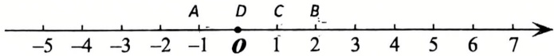

在数轴上，对于不重合的三点 A, B, C，给出如下定义：

若点 C 到点 A 的距离是点 C 到点 B 的距离的 2 倍，我们就把点 C 叫做【A, B】的和谐点.

例如：图1中，点A表示的数为-1，点B表示的数为2。表示数1的点C到点A的距离是2，到点B的距离是1。那么点C是【A，B】的和谐点；又如，表示数0的点D到点A的距离是1，到点B的距离是2，那么点D就不是【A，B】的和谐点，但点D是【B，A】的和谐点。

图 1

(1) 当点 A 表示的数为 -4，点 B 表示的数为 8 时，

① 若点 C 表示的数为 4，则点 C \_\_\_（填"是"或"不是"）【A，B】的和谐点；

② 若点 D 是 $【B, A】$ 的和谐点，则点 D 表示的数是 \_\_\_；

(2) 若 A，B 在数轴上表示的数分别为 -2 和 4，现有一点 C 从点 B 出发，以每秒 1 个单位长度的速度向数轴负半轴方向运动，当点 C 到达点 A 时停止，问点 C 运动多少秒时，C，A，B 中恰有一个点为其余两点的和谐点？

> [!question]- 点击查看答案与解析
> 【答案】（1）① 是；② $0$ 或 $-16$；（2）$2$ 秒或 $3$ 秒或 $4$ 秒
> 
> 【考点】新定义理解、数轴上点的距离、分类讨论、一元一次方程 → [[【初中数学知识点体系-人教版】#1-2 有理数及其大小比较]]
> 
> 【解析】
> （1）① $A = -4$，$B = 8$，$C = 4$。
> $C$ 到 $A$ 的距离：$|4 - (-4)| = 8$。
> $C$ 到 $B$ 的距离：$|4 - 8| = 4$。
> $8 = 2 \times 4$，所以点 $C$ 是【$A$，$B$】的和谐点。填"是"。
> 
> ② $D$ 是【$B$，$A$】的和谐点，即 $D$ 到 $B$ 的距离是 $D$ 到 $A$ 的距离的 $2$ 倍。
> 设 $D$ 表示的数为 $d$。
> $|d - 8| = 2|d + 4|$。
> 
> 两边平方：$(d-8)^2 = 4(d+4)^2$
> $d^2 - 16d + 64 = 4d^2 + 32d + 64$
> $0 = 3d^2 + 48d$
> $0 = 3d(d + 16)$
> $d = 0$ 或 $d = -16$。
> 
> 检验：$d = 0$ 时，$|0-8| = 8$，$|0+4| = 4$，$8 = 2 \times 4$ ✓；$d = -16$ 时，$|-16-8| = 24$，$|-16+4| = 12$，$24 = 2 \times 12$ ✓。
> 
> 所以 $D$ 表示的数为 $0$ 或 $-16$。
> 
> （2）$A = -2$，$B = 4$。
> 点 $C$ 从 $B$（$= 4$）出发，以每秒 $1$ 个单位的速度向负方向运动。
> $t$ 秒后，$C$ 表示的数为 $4 - t$，其中 $0 \leq t \leq 6$（到达 $A = -2$ 时停止）。
> 
> 需要讨论三种情况：
> 
> **情况一**：$C$ 是【$A$，$B$】的和谐点。
> $|C - A| = 2|C - B|$
> $|(4-t) - (-2)| = 2|(4-t) - 4|$
> $|6 - t| = 2|-t| = 2t$（因为 $t \geq 0$）
> 
> 当 $0 \leq t \leq 6$ 时，$6 - t \geq 0$，所以 $6 - t = 2t$，$t = 2$。
> 
> 检验：$t = 2$，$C = 2$。$C$ 到 $A$：$|2-(-2)| = 4$，$C$ 到 $B$：$|2-4| = 2$。$4 = 2 \times 2$ ✓。
> 
> **情况二**：$C$ 是【$B$，$A$】的和谐点。
> $|C - B| = 2|C - A|$
> $|(4-t) - 4| = 2|(4-t) - (-2)|$
> $t = 2|6 - t|$
> 
> 当 $0 \leq t \leq 6$ 时，$t = 2(6 - t)$，$t = 12 - 2t$，$3t = 12$，$t = 4$。
> 
> 检验：$t = 4$，$C = 0$。$C$ 到 $B$：$|0-4| = 4$，$C$ 到 $A$：$|0-(-2)| = 2$。$4 = 2 \times 2$ ✓。
> 
> **情况三**：$A$ 是【$C$，$B$】的和谐点。
> $|A - C| = 2|A - B|$
> $|(-2) - (4-t)| = 2|(-2) - 4|$
> $|t - 6| = 12$
> 
> $t - 6 = 12$ 或 $t - 6 = -12$
> $t = 18$（超出范围，舍去）或 $t = -6$（超出范围，舍去）。
> 
> **情况四**：$A$ 是【$B$，$C$】的和谐点。
> $|A - B| = 2|A - C|$
> $6 = 2|t - 6|$
> $|t - 6| = 3$
> 
> $t - 6 = 3$ 或 $t - 6 = -3$
> $t = 9$（超出范围，舍去）或 $t = 3$。
> 
> 检验：$t = 3$，$C = 1$。$A$ 到 $B$：$6$，$A$ 到 $C$：$|(-2)-1| = 3$。$6 = 2 \times 3$ ✓。
> 
> **情况五**：$B$ 是【$A$，$C$】的和谐点。
> $|B - A| = 2|B - C|$
> $6 = 2t$
> $t = 3$。
> 
> 检验：$t = 3$，$C = 1$。$B$ 到 $A$：$6$，$B$ 到 $C$：$|4-1| = 3$。$6 = 2 \times 3$ ✓。
> 
> **情况六**：$B$ 是【$C$，$A$】的和谐点。
> $|B - C| = 2|B - A|$
> $t = 12$（超出范围，舍去）。
> 
> 综上，满足条件的 $t$ 值为：$2$，$3$，$4$。
> 
> 点 $C$ 运动 $2$ 秒、$3$ 秒或 $4$ 秒时，$C$，$A$，$B$ 中恰有一个点为其余两点的和谐点。
> 
> 【易错点】和谐点的定义要注意顺序；三种点都可以是和谐点，需要全面分类讨论；注意运动时间的取值范围。
