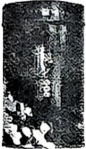
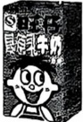
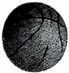

如图，下列生活物品中，从整体上看，形状是圆柱的是（）

A

B

C

D

> [!question]- 点击查看答案与解析
> 【答案】A
> 
> 【考点】圆柱、几何体识别 → [[【初中数学知识点体系-人教版】#6-1 几何图形]]
> 
> 【解析】
> 圆柱的特征是：上下两个底面是大小相等的圆，侧面是一个曲面。观察四个选项中的物品：
> - A 选项：茶叶罐，上下底面是等圆，侧面是曲面，整体形状为圆柱，正确；
> - B 选项：魔方，六个面都是正方形，整体形状为正方体，错误；
> - C 选项：篮球，整体形状为球体，错误；
> - D 选项：冰激凌筒，只有一个圆形底面，上方是锥面，整体形状为圆锥，错误。
> 
> 【易错点】不能准确区分圆柱与圆锥、球体等立体图形的特征。
