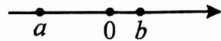

有理数 a，b 在数轴上的对应点的位置如图所示，则正确的结论是（）

A. $a + b > 0$

B. $a - b > 0$

C. $ab > 0$

D. $\frac{a}{b} < 0$

> [!question]- 点击查看答案与解析
> 【答案】D
> 
> 【考点】数轴、有理数运算符号判断 → [[【初中数学知识点体系-人教版】#1-2 有理数及其大小比较]]
> 
> 【解析】
> 由数轴可知：$a < 0 < b$，且 $|a| > |b|$。
> 逐项分析：
> - A 选项：$a$ 为负数，$b$ 为正数，且 $|a| > |b|$，所以 $a + b < 0$，错误；
> - B 选项：$a < 0$，$b > 0$，则 $a - b < 0$，错误；
> - C 选项：$a$、$b$ 异号，则 $ab < 0$，错误；
> - D 选项：$a$、$b$ 异号，则 $\frac{a}{b} < 0$，正确。
> 
> 【易错点】不能根据数轴正确判断有理数的符号及绝对值大小关系，导致运算符号判断错误。
