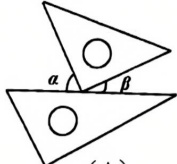
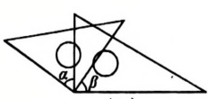
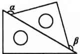
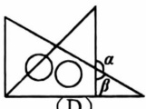

如图，一副三角尺按不同的位置摆放，下列摆放方式中 $\angle \alpha$ 与 $\angle \beta$ 互余的是（）

A

B

C

D

> [!question]- 点击查看答案与解析
> 【答案】A
> 
> 【考点】余角、三角板角度 → [[【初中数学知识点体系-人教版】#6-3 角]]
> 
> 【解析】
> 互余的定义：如果两个角的和为 $90^\circ$，则这两个角互余。
> 一副三角尺的角度分别为：$30^\circ$、$60^\circ$、$90^\circ$ 和 $45^\circ$、$45^\circ$、$90^\circ$。
> 逐项分析：
> - A 选项：$\angle \alpha$ 与 $\angle \beta$ 是由一个直角被分割而成的两个角，$\angle \alpha + \angle \beta = 90^\circ$，互余，正确；
> - B 选项：$\angle \alpha$ 与 $\angle \beta$ 是对顶角关系，二者相等但不一定互余，错误；
> - C 选项：$\angle \alpha$ 与 $\angle \beta$ 是邻补角关系，和为 $180^\circ$，互补而非互余，错误；
> - D 选项：$\angle \alpha$ 与 $\angle \beta$ 的和不等于 $90^\circ$，不互余，错误。
> 
> 【易错点】混淆互余（和为 $90^\circ$）与互补（和为 $180^\circ$）的概念。
