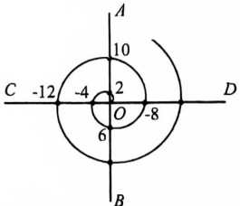

如图所示，直线 AB，CD 相交于点 O，"阿基米德曲线"从点 O 开始生成，如果将该曲线与每条射线的交点依次标记为 2，-4，6，-8，10，-12，….，如果将该曲线与每条射线...，那么标记为"-2020"的点在（）

A. 射线 OA 上

B. 射线 OB 上

C. 射线 OC 上

D. 射线 OD 上

> [!question]- 点击查看答案与解析
> 【答案】C
> 
> 【考点】规律探索 → [[【初中数学知识点体系-人教版】#3-1 列代数式表示数量关系]]
> 
> 【解析】
> 观察标记序列：$2$、$-4$、$6$、$-8$、$10$、$-12$、$\ldots$
> - 第 $n$ 个标记的绝对值为 $2n$
> - 奇数项为正，偶数项为负
> - $-2020$ 的绝对值为 $2020 = 2 \times 1010$，是第 $1010$ 个标记
> 射线按 $OA \rightarrow OB \rightarrow OC \rightarrow OD \rightarrow OA \rightarrow \cdots$ 的顺序循环，周期为 4。
> 但观察图形，实际上有 6 条射线（$OA$、$OB$、$OC$、$OD$ 及另外两条），周期为 6。
> 计算：$1010 \div 6 = 168 \cdots 2$
> 余数为 2，对应第 2 条射线。
> 从图形中可知，交点依次在 $OA$、$OB$、$OC$、$OD$、$OC$、$OB$ 方向上循环（或类似的 6 条射线循环）。
> 根据题意和图形，余数 2 对应射线 $OC$。
> 
> 【易错点】不能正确找出循环规律，或周期判断错误导致计算结果偏差。
