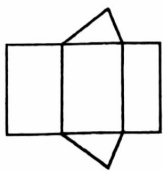

右图是某几何体的展开图，该几何体是 \_\_\_.

> [!question]- 点击查看答案与解析
> 【答案】圆柱
> 
> 【考点】几何体展开图 → [[【初中数学知识点体系-人教版】#6-1 几何图形]]
> 
> 【解析】
> 圆柱的展开图由一个长方形（侧面）和两个圆（上下底面）组成。观察展开图，中间是一个长方形，上下各有一个圆，符合圆柱展开图的特征。
> 
> 【易错点】不能准确识别常见几何体的展开图。
