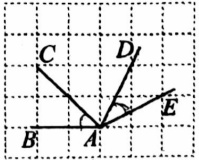

如图所示的网格是正方形网格， $\angle BAC$ \_\_\_ $\angle DAE$ （填"＞"，"＝"或"＜"）

> [!question]- 点击查看答案与解析
> 【答案】$>$
> 
> 【考点】角的大小比较 → [[【初中数学知识点体系-人教版】#6-3 角]]
> 
> 【解析】
> 观察网格图，$\angle BAC$ 和 $\angle DAE$ 的顶点都在格点上。
> $\angle BAC$ 的两边所跨的网格范围更大，张开的角度更大；$\angle DAE$ 的两边相对更靠近，张开的角度更小。
> 因此 $\angle BAC > \angle DAE$。
> 
> 【易错点】仅凭直观感觉比较角的大小而不结合网格特征分析。
