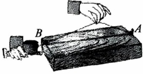

如图，经过刨平的木板上的 A，B 两个点，可以弹出一条笔直的墨线．能解释这一实际应用的数学知识是 \_\_\_

> [!question]- 点击查看答案与解析
> 【答案】两点确定一条直线
> 
> 【考点】两点确定一条直线 → [[【初中数学知识点体系-人教版】#6-2 直线、射线、线段]]
> 
> 【解析】
> 经过刨平的木板上的 $A$、$B$ 两个点可以弹出一条笔直的墨线，这是因为"两点确定一条直线"，即经过两点有且只有一条直线。
> 
> 【易错点】不能将实际应用与数学基本性质对应起来。
