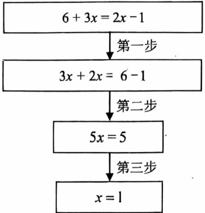

下面的框图表示了琳琳同学解方程 $6 + 3x = 2x - 1$ 的流程：

你认为琳琳同学在解这个方程的过程中从第\_\_\_步开始出现问题，正确完成这一步的依据是\_\_\_.

> [!question]- 点击查看答案与解析
> 【答案】一；等式的基本性质1（等式两边同时加上或减去同一个数，等式仍然成立）
> 
> 【考点】解方程步骤和依据 → [[【初中数学知识点体系-人教版】#5-2 解一元一次方程]]
> 
> 【解析】
> 解方程 $6 + 3x = 2x - 1$：
> 正确步骤应为：移项得 $3x - 2x = -1 - 6$（等式两边同时减去 $2x$，再减去 6），合并同类项得 $x = -7$。
> 琳琳的做法：$3x - 2x = -1 + 6$，她在移项时没有改变 6 的符号，从第一步就开始出错。
> 正确完成移项的依据是等式的基本性质1：等式两边同时加上或减去同一个数，等式仍然成立。
> 
> 【易错点】移项时忘记变号。
