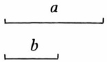
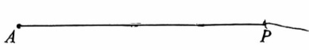

下面是小明某次作图的过程.

已知：如图，线段 a，b.

作法：

① 画射线AP；

② 用圆规在射线 AP 上截取一点 B，使线段 AB = a；

③ 用圆规在射线 AP 上截取一点 C，使线段 BC = b.

根据小明的作图过程，

(1) 补全所有符合小明作图过程的图形；（保留作图痕迹）

(2) 线段 $AC=$ \_\_\_ .（用含 a, b 的式子表示）

> [!question]- 点击查看答案与解析
> 【答案】(1) 见解析；(2) $a+b$ 或 $|a-b|$
> 
> 【考点】尺规作图、线段和差 → [[【初中数学知识点体系-人教版】#6-2 直线、射线、线段]]
> 
> 【解析】
> (1) 根据作法：
> - 先画射线 $AP$
> - 在射线 $AP$ 上截取 $AB = a$
> - 在射线 $AP$ 上截取 $BC = b$
> 
> 由于点 $C$ 在射线 $AP$ 上且 $BC = b$，点 $C$ 有两种可能的位置：
> - 点 $C$ 在点 $B$ 的右侧（远离点 $A$），此时 $A$、$B$、$C$ 从左到右排列；
> - 点 $C$ 在点 $B$ 的左侧（靠近点 $A$），此时点 $C$ 可能在线段 $AB$ 上或在点 $A$ 左侧。
> 
> 补全图形时应画出这两种情况（保留圆规截取痕迹）。
> 
> (2) 
> - 当点 $C$ 在点 $B$ 右侧时：$AC = AB + BC = a + b$
> - 当点 $C$ 在点 $B$ 左侧时：$AC = |AB - BC| = |a - b|$
> 
> 【易错点】忽略点 $C$ 的两种可能位置，只考虑一种情况。
