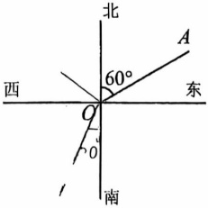

如图，货轮 O 在航行过程中，发现灯塔 A 在它北偏东 $ 60^{\circ} $ 的方向上．同时，在它南偏西 $20^{\circ}$ 、西北（即北偏西 $45^{\circ}$ ）方向上又分别发现了客轮 B 和海岛 C．仿照表示灯塔方位的方法，画出表示客轮 B 和海岛 C 方向的射线．

> [!question]- 点击查看答案与解析
> 【答案】见解析
> 
> 【考点】方位角 → [[【初中数学知识点体系-人教版】#6-3 角]]
> 
> 【解析】
> 以货轮 $O$ 为顶点，以正北方向为基准：
> - 客轮 $B$ 在南偏西 $20^\circ$ 方向：从正南方向向西偏转 $20^\circ$ 画出射线 $OB$；
> - 海岛 $C$ 在西北方向（北偏西 $45^\circ$）：从正北方向向西偏转 $45^\circ$ 画出射线 $OC$。
> 
> 作图时注意：
> - 先画出东西南北四个方向
> - 南偏西 $20^\circ$：从正南方向线开始，向西（左侧）旋转 $20^\circ$
> - 北偏西 $45^\circ$：从正北方向线开始，向西（左侧）旋转 $45^\circ$
> - 标注射线 $OB$ 和射线 $OC$，并注明角度
> 
> 【易错点】方位角的方向判断错误，将"南偏西"与"北偏西"混淆。
