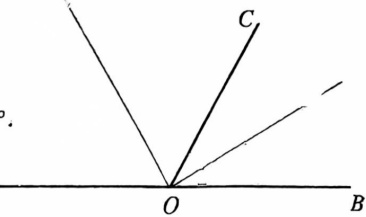

如图，O 是直线 AB 上一点， $\angle BOC = 60^\circ$。作射线 OD，OE，使得 OD 平分 $\angle AOC$，OE 平分 $\angle BOC$。求 $\angle DOE$ 的度数。

(1) 请依据题意补全图形;

(2) 完成下面的解答过程:

解：因为 O 是直线 AB 上一点，所以 $\angle AOC + \angle BOC = 180^\circ$

由 $\angle BOC = 60^\circ$，得 $\angle AOC =$\_\_\_。

因为 OD 平分 $\angle AOC$，所以 $\angle COD = (\ ) \times \angle AOC =$\_\_\_。

因为 OE 平分 ∠BOC，所以 ∠COE = （ ）× ∠BOC = \_\_\_°.

所以 $\angle DOE = \angle COD + \angle COE = \_\_\_\_\_^\circ.$

> [!question]- 点击查看答案与解析
> 【答案】(1) 见解析；(2) $120^\circ$，$\frac{1}{2}$，$60^\circ$，$\frac{1}{2}$，$30$，$90$
> 
> 【考点】角平分线 → [[【初中数学知识点体系-人教版】#6-3 角]]
> 
> 【解析】
> (1) 补全图形：
> - 作 $\angle AOC$ 的平分线 $OD$（在 $\angle AOC$ 内部，使得 $\angle AOD = \angle COD$）
> - 作 $\angle BOC$ 的平分线 $OE$（在 $\angle BOC$ 内部，使得 $\angle BOE = \angle COE$）
> 
> (2) 解答过程：
> 因为 $O$ 是直线 $AB$ 上一点，所以 $\angle AOC + \angle BOC = 180^\circ$
> 由 $\angle BOC = 60^\circ$，得 $\angle AOC = 120^\circ$。
> 因为 $OD$ 平分 $\angle AOC$，所以 $\angle COD = \frac{1}{2} \times \angle AOC = 60^\circ$。
> 因为 $OE$ 平分 $\angle BOC$，所以 $\angle COE = \frac{1}{2} \times \angle BOC = 30^\circ$。
> 所以 $\angle DOE = \angle COD + \angle COE = 90^\circ$。
> 
> 【易错点】不能正确运用角平分线的定义；混淆 $\angle DOE = \angle COD + \angle COE$ 与 $\angle DOE = \angle COD - \angle COE$ 的关系。
