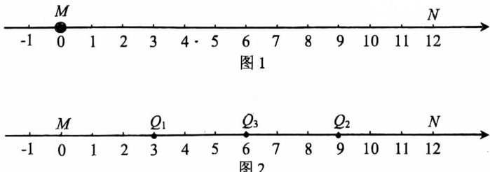

小刚运用本学期的知识，设计了一个数学探究活动。如图 1，数轴上的点 M，N 所表示的数分别为 0，12。将一枚棋子放置在点 M 处，让这枚棋子沿数轴在线段 MN 上往复运动（即棋子从点 M 出发沿数轴向右运动，当运动到点 N 处，随即沿数轴向左运动，当运动到点 M 处，随即沿数轴向右运动，如此反复…）。并且规定棋子按照如下的步骤运动：第 1 步，从点 M 开始运动 t 个单位长度至点 $Q_{1}$ 处；第 2 步，从点 $Q_{1}$ 继续运动 2t 个单位长度至点 $Q_{2}$ 处；第 3 步，从点 $Q_{2}$ 继续运动 3t 个单位长度至点 $Q_{3}$ 处…。

例如：当 t=3 时，点 $Q_{1}$， $Q_{2}$， $Q_{3}$ 的位置如图 2 所示.

解决如下问题：

(1) 如果 t=4，那么线段 $Q_{1}Q_{3}$ = \_\_\_；

(2) 如果 t<4，且点 $Q_{3}$ 表示的数为 3，那么 t = \_\_\_；

(3) 如果 $t \leqslant 2$，且线段 $Q_{2}Q_{4} = 2$，那么请你求出 t 的值.

> [!question]- 点击查看答案与解析
> 【答案】(1) 4；(2) $\frac{1}{2}$ 或 $\frac{7}{2}$；(3) $t = \frac{2}{7}$ 或 $t = \frac{22}{13}$ 或 $t = 2$
> 
> 【考点】数轴上的动点问题 → [[【初中数学知识点体系-人教版】#1-2 有理数及其大小比较]]
> 
> 【解析】
> 线段 $MN$ 长为 12，棋子在 $[0, 12]$ 上往复运动。第 $n$ 步运动 $nt$ 个单位长度。
> 
> 设累计移动距离为 $S_n = t + 2t + \cdots + nt = \frac{n(n+1)}{2}t$。
> 棋子位置 $Q_n$ 需要用"折返"模型计算：在 $[0, 12]$ 上来回运动，以 24 为周期。
> 
> (1) 当 $t = 4$ 时：
> $Q_1$：$S_1 = 4$，在 $[0, 12]$ 内，$Q_1 = 4$
> $Q_2$：$S_2 = 4 + 8 = 12$，恰好到达 $N$ 点，$Q_2 = 12$
> $Q_3$：$S_3 = 12 + 12 = 24$，从 $N$ 点往回走 12 个单位，$Q_3 = 0$
> 
> $Q_1Q_3 = |4 - 0| = 4$
> 
> (2) 当 $t < 4$ 且 $Q_3 = 3$ 时：
> $S_3 = 6t$
> 
> 因为 $t < 4$，所以 $6t < 24$。分情况讨论：
> - 若 $6t \leqslant 12$，即 $t \leqslant 2$：$Q_3 = 6t = 3$，得 $t = \frac{1}{2}$，符合 $t \leqslant 2$。
> - 若 $12 < 6t < 24$，即 $2 < t < 4$：$Q_3 = 24 - 6t = 3$，得 $6t = 21$，$t = \frac{7}{2} = 3.5$。
> 
> 验证 $t = \frac{7}{2}$：$S_1 = 3.5$，$S_2 = 10.5$，$S_3 = 21$。
> $Q_1 = 3.5$，$Q_2 = 10.5$，$Q_3 = 24 - 21 = 3$，符合。
> 
> 综上，$t = \frac{1}{2}$ 或 $t = \frac{7}{2}$。
> 
> (3) 当 $t \leqslant 2$ 且 $Q_2Q_4 = 2$ 时：
> $S_2 = 3t$，$S_4 = 10t$
> 
> 因为 $t \leqslant 2$，$S_2 = 3t \leqslant 6 < 12$，所以 $Q_2 = 3t$。
> 
> $S_4 = 10t$，因为 $t \leqslant 2$，所以 $S_4 \leqslant 20 < 24$。
> - 当 $t \leqslant 1.2$ 时，$S_4 = 10t \leqslant 12$，$Q_4 = 10t$
> - 当 $1.2 < t \leqslant 2$ 时，$S_4 = 10t > 12$，$Q_4 = 24 - 10t$
> 
> 情况一：$t \leqslant 1.2$
> $Q_2Q_4 = |3t - 10t| = 7t = 2$
> $t = \frac{2}{7} \approx 0.286 \leqslant 1.2$，符合。
> 
> 情况二：$1.2 < t \leqslant 2$
> $Q_2Q_4 = |3t - (24 - 10t)| = |13t - 24| = 2$
> $13t - 24 = 2$ 或 $13t - 24 = -2$
> $t = \frac{26}{13} = 2$ 或 $t = \frac{22}{13} \approx 1.69$
> 
> $t = 2$：$1.2 < 2 \leqslant 2$，符合。
> $t = \frac{22}{13}$：$1.2 < \frac{22}{13} \approx 1.69 \leqslant 2$，符合。
> 
> 验证 $t = 2$：$Q_2 = 6$，$S_4 = 20$，$Q_4 = 24 - 20 = 4$，$Q_2Q_4 = |6 - 4| = 2$，符合。
> 
> 综上，$t = \frac{2}{7}$ 或 $t = \frac{22}{13}$ 或 $t = 2$。
> 
> 【易错点】不能正确理解棋子往复运动的位置计算方法；漏掉分类讨论的情况；折返点的位置计算错误。
