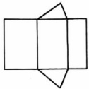

右图是某个几何题的展开图，该几何体是（）

A. 三棱柱

B. 圆锥

C. 四棱柱

D. 圆柱

> [!question]- 点击查看答案与解析
> 【答案】A
> 
> 【考点】几何体展开图 → [[【初中数学知识点体系-人教版】#6-1 几何图形]]
> 
> 【解析】
> 展开图由两个三角形和三个矩形组成，符合三棱柱的特征。圆锥展开图是扇形加圆，圆柱展开图是矩形加两个圆，四棱柱展开图是六个矩形。
> 
> 【易错点】不能准确识别展开图对应的立体几何体。
