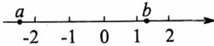

实数 a, b 在数轴上的对应点的位置如图所示，则正确的结论是（）

A.  $|a|<|b|$

B.  $a>-b$

C.  $b>a$

D.  $b>2$

> [!question]- 点击查看答案与解析
> 【答案】C
> 
> 【考点】数轴上数的大小比较、绝对值 → [[【初中数学知识点体系-人教版】#1-2 有理数及其大小比较]]
> 
> 【解析】
> 由数轴可知：$a$ 在 $-2$ 和 $-1$ 之间，$b$ 在 $0$ 和 $1$ 之间。
> A：$|a|>1$，$|b|<1$，所以 $|a|>|b|$，A 错误。
> B：$a<0$，$-b<0$，但 $|a|>|b|$，所以 $a<-b$，B 错误。
> C：$b$ 是正数，$a$ 是负数，正数大于负数，所以 $b>a$，C 正确。
> D：$b<1<2$，D 错误。
> 
> 【易错点】数轴读数不准确；绝对值比较出错。
