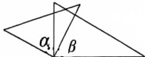
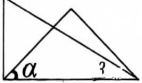
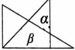
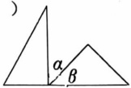

将一副三角板按如图所示位置摆放，其中  $\angle\alpha = \angle\beta$ 的是（）

①

②

③

④

A. $①②$

B. $②③$

C. $①④$

D. $②④$

> [!question]- 点击查看答案与解析
> 【答案】C
> 
> 【考点】角的比较、三角板角度 → [[【初中数学知识点体系-人教版】#6-3 角]]
> 
> 【解析】
> 一副三角板包含两个：$45°$-$45°$-$90°$ 的等腰直角三角板和 $30°$-$60°$-$90°$ 的直角三角板。
> $①$ 两个角都是 $45°$（等腰直角三角板的两个锐角），$\angle\alpha=\angle\beta=45°$。
> $②$ 两角不一定相等。
> $③$ 两角不一定相等。
> $④$ $\angle\alpha$ 和 $\angle\beta$ 都是同一个角的余角，根据同角的余角相等，$\angle\alpha=\angle\beta$。
> 因此 $①④$ 正确。
> 
> 【易错点】不能识别三角板各角的度数；不理解同角的余角相等。
